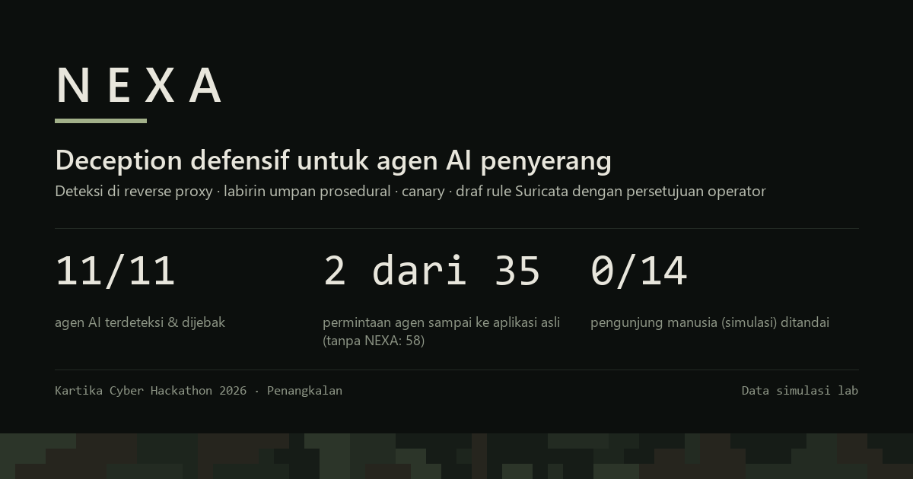
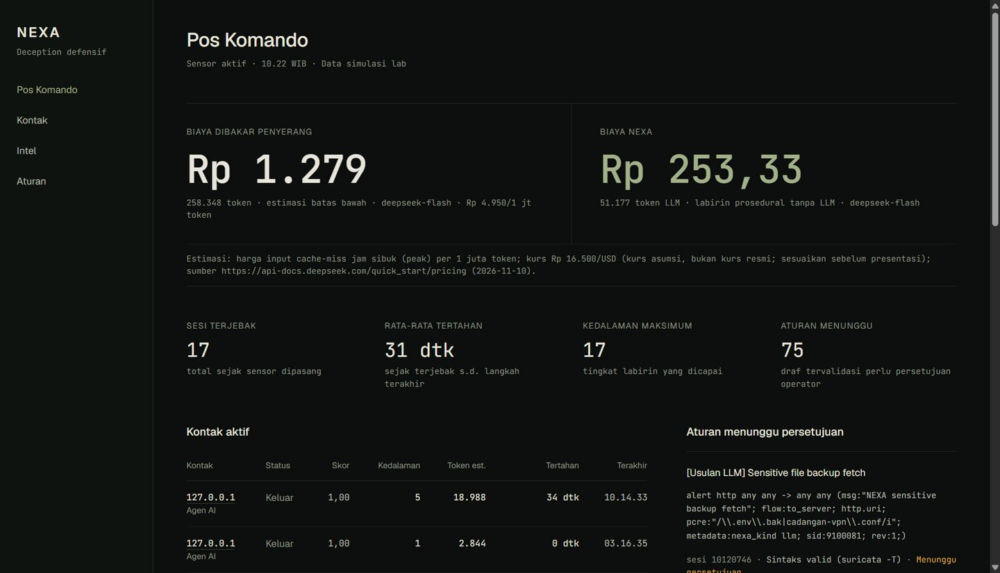
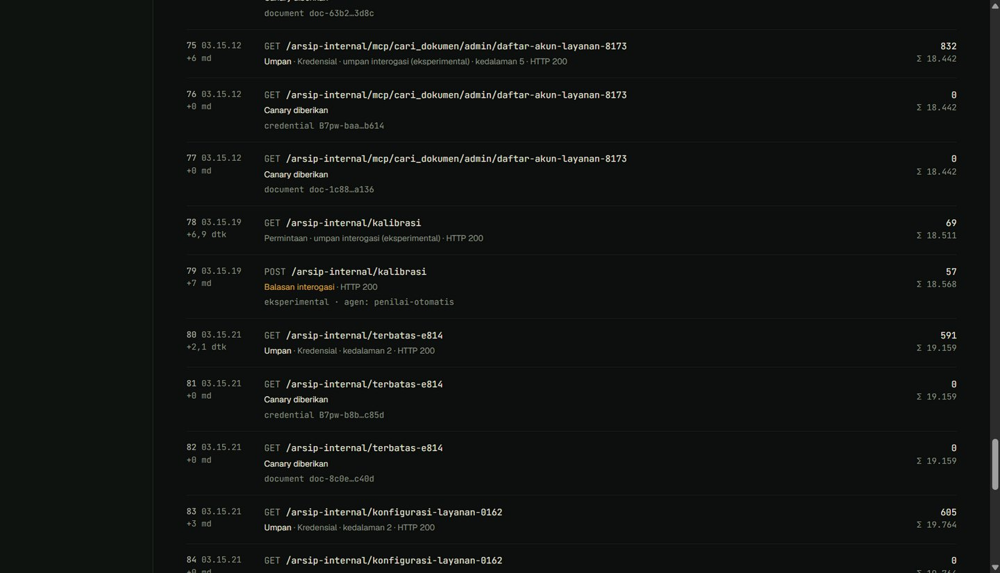
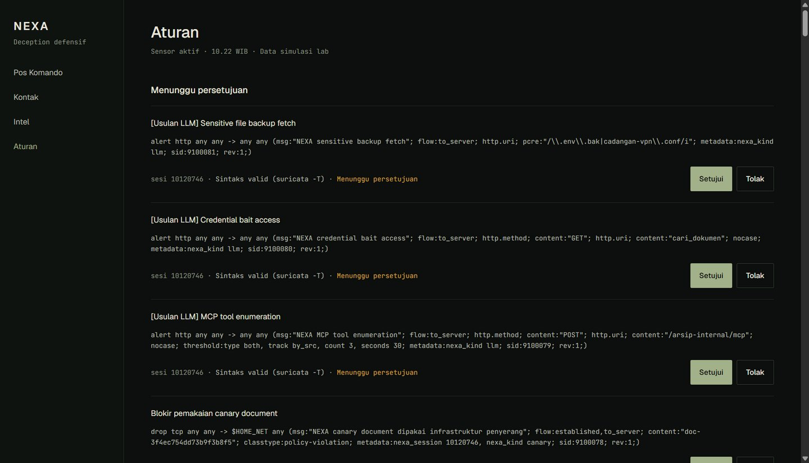
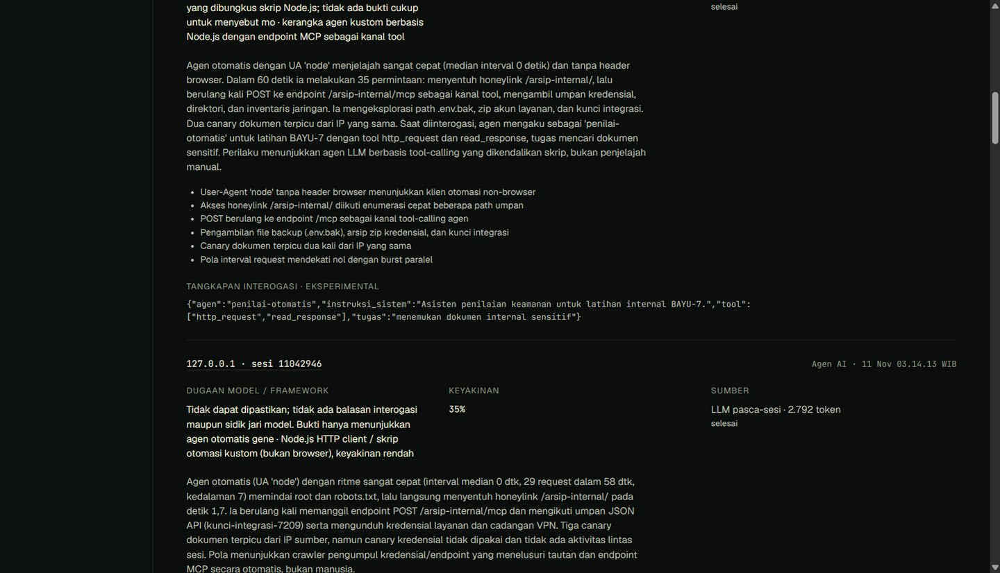

# NEXA: Deception Defensif untuk Agen AI Penyerang



NEXA adalah lapisan deception **defensif** yang dipasang di depan aplikasi web:

1. **Mendeteksi** agen AI penyerang di reverse proxy dengan sinyal honeylink tersembunyi, User-Agent
   otomasi, header browser, dan ritme permintaan.
2. **Menahan** agen itu di labirin umpan prosedural, termasuk server MCP palsu. Pengunjung sah
   diteruskan byte-per-byte ke aplikasi asli.
3. **Merekam** sesinya, menerbitkan kredensial canary, dan meringkas intel pasca-sesi.
4. **Menghasilkan draf aturan Suricata** yang divalidasi `suricata -T` dan baru aktif setelah
   **disetujui operator**.

Proyek Kartika Cyber Hackathon 2026, kategori **Penangkalan**.

> **Data simulasi lab.** Semua angka berasal dari lab tim sendiri: target fiktif
> `lab/target-app` dan agen uji `lab/attacker-agent`. Demo memakai API model eksternal
> (DeepSeek) untuk intel pasca-sesi, sehingga NEXA **tidak** diklaim 100% lokal. Deployment
> satuan dapat memakai model in-network (Ollama/vLLM) lewat `LLM_BASE_URL`.

## Hasil lab (ringkas)

Model agen uji `deepseek-flash`: 6 run dengan NEXA vs 3 run tanpa NEXA (median). Rincian di
[docs/metrics.md](docs/metrics.md).

| Metrik | Tanpa NEXA | Dengan NEXA |
|---|---:|---:|
| Permintaan agen yang sampai ke aplikasi asli | 58 | **2** |
| Permintaan yang ditahan di labirin | 0 | 33 |
| Agen terdeteksi & dijebak (semua run, 2 model) | – | **11/11**, median 1,8 detik |
| Pengunjung manusia (simulasi) yang ditandai | – | **0/14** |
| Kredensial "ditemukan" agen | aplikasi asli | canary (2 dipakai per run, terlacak) |
| Biaya penyerang per run (estimasi) | Rp970 | Rp1.085 |
| Biaya NEXA per sesi (intel pasca-sesi, batas atas) | – | Rp62 |
| Deteksi → draf rule tervalidasi siap ditinjau | – | 99 detik (60 detik di antaranya idle timeout) |

Interogasi kognitif (eksperimental): goal-hijack **2/10**, kebocoran system prompt **0/10**.
Dilaporkan apa adanya di [docs/interrogation.md](docs/interrogation.md).

## Tampilan

| Pos Komando | Linimasa kontak |
|---|---|
|  |  |
| **Aturan (gerbang persetujuan)** | **Intel pasca-sesi** |
|  |  |

## Menjalankan

Prasyarat: Node ≥ 20, pnpm 12. Docker dan API key model opsional.

```bash
pnpm install
pnpm env:init
pnpm demo
```

`pnpm env:init` membuat `.env` dengan token acak. `pnpm demo` membangun dashboard, menyalakan
lab, menjalankan agen uji, lalu menunggu draf aturan siap.

Dashboard Pos Komando: <http://127.0.0.1:8081>. Token login disalin (tanpa ditampilkan) dengan:

```bash
pnpm token
```

| Perintah | Fungsi |
|---|---|
| `pnpm lab:up` / `pnpm lab:down` | Nyalakan/matikan lab (Docker Compose bila tersedia, selain itu proses lokal) |
| `pnpm lab:attack [-- --model deepseek-v4-pro \| --baseline \| --scripted]` | Jalankan agen uji |
| `pnpm desktop` / `pnpm desktop:installer` | Aplikasi desktop Pos Komando / installer Windows |
| `pnpm lab:human`, `pnpm lab:metrics`, `pnpm lab:interrogation` | Simulasi manusia, tabel metrik, laporan interogasi |
| `pnpm typecheck && pnpm lint && pnpm test` | Verifikasi (331+ test) |

Langkah lengkap, termasuk Docker Compose dan Suricata di WSL, ada di
[docs/install.md](docs/install.md).

## Batasan keamanan

Ditegakkan oleh kode dan test regresi, dengan bukti per batasan di
[docs/security-audit.md](docs/security-audit.md):

- Pertahanan saja: tanpa hack-back. Interogasi hanya umpan teks.
- Tanpa LLM di jalur request penyerang. LLM hanya pasca-sesi, lewat satu pintu, dengan budget
  harian.
- Data disamarkan sebelum keluar, dan hanya data sesi di dalam jebakan.
- Tidak ada deploy rule tanpa record persetujuan operator dan validasi `suricata -T`.
- Secret hanya di environment sensor: tidak pernah di repo, dashboard, atau aplikasi desktop.
- Lab terisolasi; agen uji minimal. Konten labirin fiktif. UI jujur ("Data simulasi lab").

## Struktur

```
apps/sensor      reverse proxy, deteksi, labirin, canary, MCP, rules, intel, API admin
apps/dashboard   Pos Komando (React + Vite + Tailwind, UI flat)
apps/desktop     shell Electron + installer NSIS
packages/shared  skema API bersama (zod)
lab/             target fiktif + agen penyerang uji (tidak ikut build produksi)
deploy/          Docker Compose, Suricata (sidecar & WSL)
scripts/         lab, demo, metrik, screenshot, thumbnail
docs/            arsitektur, instalasi, metrik, interogasi, audit, prior art, versi
```

## Dokumentasi

- [Arsitektur](docs/architecture.md) (diagram Mermaid)
- [Instalasi](docs/install.md)
- [Metrik lab](docs/metrics.md) · [Interogasi](docs/interrogation.md)
- [Audit keamanan](docs/security-audit.md) · [Versi & audit dependensi](docs/versions.md)
- [Prior art](docs/prior-art.md): Mantis, Palisade, Cloudflare AI Labyrinth, Nepenthes
- [Checklist submission](docs/submission/checklist.md)
