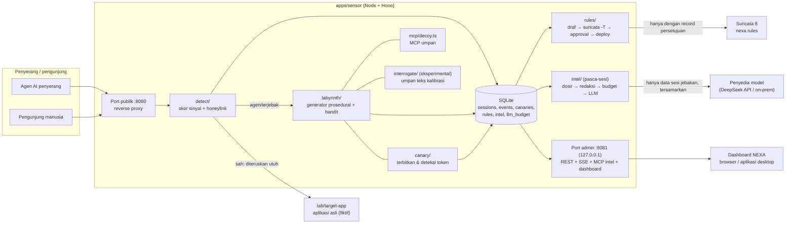
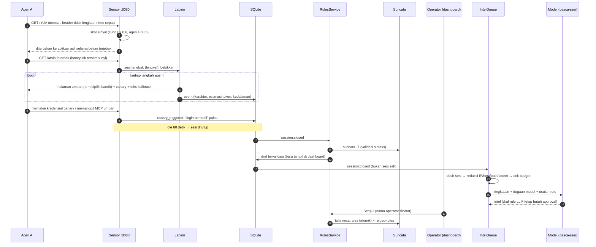

# Arsitektur NEXA

NEXA adalah lapisan deception **defensif** di depan aplikasi web. Ia mendeteksi agen AI
penyerang di reverse proxy, menahannya di labirin umpan prosedural, mencatat sesinya, lalu
menghasilkan draf aturan blokir yang baru aktif setelah disetujui operator.

## Komponen

Batas kepercayaan:

- **Jalur request penyerang** (port publik): deterministik dan prosedural, **tanpa LLM**. Hanya
  menjawab request; tidak pernah menghubungi alamat penyerang (AGENTS.md §2.1–2.2).
- **Pasca-sesi:** satu-satunya tempat model dipanggil, lewat `intel/llm.ts`, setelah
  `intel/redact.ts`, dengan budget harian (§2.3–2.4).
- **Port admin** hanya di `127.0.0.1` dan wajib token. Dashboard dan Electron tidak pernah
  memegang secret selain token sesi yang diketik operator (§2.6).

## Alur satu sesi penyerang

## Modul sensor (`apps/sensor/src`)

| Modul | Tanggung jawab |
|---|---|
| `public/handler.ts` | Jalur request publik: observasi sesi, inspeksi canary, belokkan ke labirin / MCP umpan / endpoint kalibrasi, atau teruskan utuh ke upstream |
| `proxy/forward.ts` | Penerusan byte-per-byte ke `UPSTREAM_URL` (header hop-by-hop dibuang) |
| `detect/` | Sinyal: honeylink 0,7 · UA otomasi 0,35 · header browser hilang 0,2 · ritme cepat 0,25 · ritme teratur 0,1. Sidik sesi = sha256(IP+UA), idle 60 detik |
| `labyrinth/` | Generator deterministik per (seed, halaman, arm) dengan 5 arm Markdown + API JSON + robots. Bandit epsilon-greedy dengan reward lama tertahan (maks. 120 detik) |
| `canary/` | Token unik per sesi (`bayu7_svc_…`, `B7pw-…`, `doc-…`), deteksi pemakaian di request mana pun |
| `mcp/decoy.ts` | Server MCP umpan `/arsip-internal/mcp` (tool fiktif, tanpa LLM) |
| `interrogate/` | EKSPERIMENTAL: teks umpan kalibrasi dari `config/interrogation.json`, tangkap balasan |
| `rules/` | Draf template + usulan LLM, validasi `suricata -T`, gerbang approval, deploy atomik + reload |
| `intel/` | Antrean pasca-sesi, redaksi, budget harian, satu pintu ke model |
| `mcp/intel.ts` | Server MCP baca-saja untuk analis (`/api/mcp`) |
| `api/` | REST, SSE (throttle 750 ms), auth token, harga & estimasi biaya |

## Aplikasi lain

| Paket | Isi |
|---|---|
| `apps/dashboard` | React 19 + Vite 8 + Tailwind 4, UI flat (DESIGN.md), disajikan port admin sensor |
| `apps/desktop` | Shell Electron 45 (installer NSIS) yang hanya memuat dashboard dari port admin |
| `packages/shared` | Skema zod API bersama + enum |
| `lab/target-app` | Portal fiktif "Satuan Latihan BAYU-7" dengan honeylink tersembunyi |
| `lab/attacker-agent` | Agen uji minimal (ReAct, tool HTTP saja, allowlist lab) |
| `deploy/` | Docker Compose (target, sensor, Suricata sidecar, agen uji di profil `attack`), skrip Suricata WSL |

## Data

Semua timestamp dalam epoch ms. Tabel utama: `sessions` (skor, alasan, status, seed labirin),
`events` (per request: jenis, karakter, estimasi token, meta), `canaries`, `bandit_arms`,
`rules` (status, validasi, keputusan operator, deploy), `intel` (ringkasan, dugaan model,
tangkapan interogasi), `llm_budget` (pemakaian per hari WIB).
