# Konsep Logo NEXA

Disusun 12 November 2026 sebagai pengganti logo lama (huruf N dalam bingkai). Dua belas konsep
di bawah ini berupa SVG flat di grid 64 unit dengan warna token DESIGN.md: tulang `#E8E6DC`,
aksen sage `#A3B18A`, dan latar `#0C0F0D`. Filenya ada di [`logo-concepts/`](logo-concepts/).

**Keputusan (12 November 2026):** konsep 01 Simpul dipilih dan disempurnakan menjadi logo final.
Lihat [logo.md](logo.md).

## Riset

### Pola merek pertahanan modern

- **Anduril** dinamai dari pedang Andúril dalam karya Tolkien, dan logonya diturunkan dari
  gagang pedang itu.
- **Palantir** dinamai dari batu penglihat (palantír), dan logonya berupa bola di atas dudukan.

Pelajarannya: tanda yang kuat diturunkan dari benda atau makna di balik nama, lalu digambar
sebagai geometri sederhana yang tetap bekerja dalam satu warna. Klise keamanan seperti perisai,
gembok, mata, sosok berhoodie, dan papan sirkuit sengaja dihindari.

### Makna yang dimiliki NEXA

| Sumber | Fakta | Untuk NEXA |
|---|---|---|
| Etimologi Latin | *nexa* adalah bentuk feminin participle *nexus*, dari *nectō* "mengikat": terikat, terjalin, terhubung. Sebagai kata benda, *nexus* berarti ikatan atau sambungan. | NEXA mengikat agen di dalam labirin, dan berdiri di titik temu tempat lalu lintas dipisah. |
| Labirin klasik | Koin Knossos sejak sekitar 430 SM memakai labirin unicursal: satu jalur tanpa cabang dan tanpa jalan buntu. | Setiap halaman umpan menautkan halaman berikutnya. Tanpa jalan buntu, agen tidak pernah menemukan alasan berhenti. |
| Kurva Hilbert (1891) | Satu kurva kontinu yang dibangun rekursif (empat salinan dirinya) dan pada limitnya melewati setiap titik persegi. | Labirin prosedural yang deterministik per seed dan selalu punya tingkat lebih dalam. |
| Gunungan wayang | Kayon gapuran memuat gapura yang dijaga dua raksasa penentu siapa boleh masuk. Kayon membuka dan menutup adegan, dan bentuknya mengerucut ke atas. | NEXA sebagai dalang dan penjaga gapura: penyerang hanya melihat bayangan di kelir. |
| Borobudur | Pradaksina dilakukan searah jarum jam dari tangga timur, melewati 1.460 panel relief naratif. Ada 72 stupa di tiga teras melingkar. | Jalan panjang yang berputar melewati galeri cerita. |
| Kartika | Dari Sanskerta *Kṛttikā* (gugus Pleiades). Dalam tradisi Jawa disebut Lintang Kartika, "bintangnya bintang". Juga nama hackathon ini. | Bintang penunjuk arah bagi operator. |
| Fata Morgana | Fatamorgana superior yang kompleks: citra tegak dan terbalik bertumpuk di cakrawala. | Dunia umpan yang tampak nyata. |
| Ouroboros, benang Ariadne | Mitologi umum: ular yang memakan ekornya, dan benang yang diberikan Ariadne kepada Theseus untuk keluar dari labirin. | Penyerang yang memakan sumber dayanya sendiri, dan perekaman sesi. |

## Prinsip desain

1. **Makna dari nama dan produk,** bukan klise keamanan.
2. **Flat dengan token DESIGN.md.** Bentuk utama berwarna tulang, aksen sage dipakai hemat
   (satu elemen), di atas latar gelap. Tanda tetap harus terbaca dalam satu warna.
3. **Grid 64 unit** dengan garis 5 unit dan ujung persegi, meneruskan DNA logo lama.
4. **Lolos uji 16 px** (favicon, ikon tab) dan ikon aplikasi desktop.
5. **Bukan lambang institusi.** DESIGN.md melarang lambang resmi TNI AD/PUSSIBERAD. Semua
   konsep di sini adalah geometri orisinal.

## Dua belas konsep

### 01 · Simpul: yang terikat tak pernah lepas

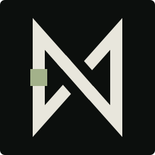

- **Desain.** Satu garis tertutup yang terdiri dari dua tiang N dan dua diagonal yang
  bersilangan. Diagonal yang kembali lewat di bawah diagonal N, sehingga terbentuk simpul tanpa
  ujung. Ada manik sage di tiang kiri. Huruf N, X di tengah, dan angka delapan persegi (∞)
  terbaca dalam satu tanda.
- **Filosofi.** *Nexa* berarti "yang terikat". Agen masuk lewat satu tiang lalu berputar di
  simpul yang sama tanpa akhir; manik sage adalah agen yang terikat itu. X di tengah adalah
  *nexus*, titik temu tempat jalurnya dipisahkan.
- **Catatan.** Monogram yang kuat dan tetap jelas di 16 px. Sudut lancipnya menjaga karakter
  tajam logo lama.

### 02 · Kurva Hilbert: satu jalur mengisi seluruh ruang

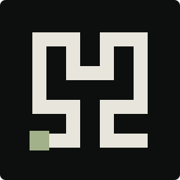

- **Desain.** Kurva Hilbert orde 2: satu garis siku yang melewati ke-16 sel grid 4×4 tepat
  sekali. Titik masuknya diberi kotak sage.
- **Filosofi.** Hilbert menunjukkan bahwa satu garis bisa mengisi seluruh persegi lewat
  rekursi, karena tiap tingkat berisi empat salinan tingkat sebelumnya. Labirin NEXA bekerja
  dengan cara yang sama: prosedural, deterministik per seed, dan selalu punya tingkat lebih
  dalam. Kotak sage adalah titik masuk penyerang, sekaligus benihnya.
- **Catatan.** Sangat tajam di ukuran kecil, dengan nuansa teknis dan matematis.

### 03 · Labirin Benih: tanpa jalan buntu, agen tak berhenti

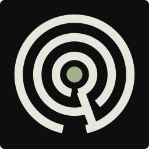

- **Desain.** Tiga dinding melingkar dengan celah bergantian dan satu sekat radial. Hasilnya
  satu jalur unicursal dari bawah ke pusat, dengan titik sage di pusatnya.
- **Filosofi.** Labirin klasik di koin Knossos tidak punya jalan buntu; isinya satu jalur
  panjang yang terus berbalik. NEXA memakai prinsip yang sama: setiap halaman umpan menautkan
  halaman berikutnya, jadi agen tidak pernah menemukan alasan untuk berhenti. Pusatnya adalah
  benih, karena seluruh labirin tumbuh dari seed.
- **Catatan.** Di 16 px terbaca sebagai lingkaran konsentris. Paling kuat di ukuran sedang.

### 04 · Persimpangan: satu pintu, dua takdir

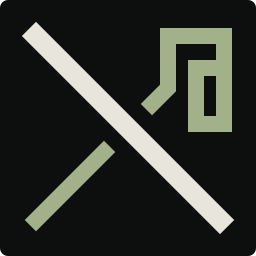

- **Desain.** Huruf X dari NEXA. Garis tulang menembus lurus dari kiri atas ke kanan bawah,
  sementara garis sage lewat di bawahnya lalu tertekuk menjadi spiral siku.
- **Filosofi.** NEXA berdiri di titik temu. Pengunjung sah diteruskan lurus byte-per-byte,
  sedangkan agen dibelokkan dan berputar di labirin.
- **Catatan.** Paling langsung menjelaskan arsitektur produk. Spiralnya kecil, jadi perlu versi
  sederhana untuk favicon.

### 05 · Gunungan: dalang di balik kelir

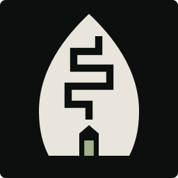

- **Desain.** Siluet gunungan wayang. Di dalamnya ada jalur siku berliku yang mendaki dari
  gapura ke puncak, dan cahaya sage di ambang gapura.
- **Filosofi.** Dalam wayang kulit, penonton hanya melihat bayangan di kelir sementara dalang
  mengendalikan cerita dari balik layar. Penyerang hanya melihat bayangan (dunia umpan), dan
  NEXA adalah dalangnya. Gapura pada kayon gapuran dijaga dua raksasa yang menentukan siapa
  boleh masuk, persis peran reverse proxy NEXA. Jalan berliku adalah labirinnya, dan cahaya di
  ambang adalah honeylink.
- **Catatan.** Siluet paling mudah diingat dan paling khas Indonesia, sehingga sangat kuat untuk
  Kartika Cyber.

### 06 · Mandala Pradaksina: berputar di galeri cerita

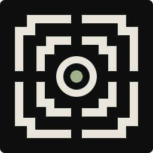

- **Desain.** Denah atas candi: teras persegi berundak dengan empat tangga di tengah sisi, teras
  melingkar, dan stupa sage di pusat.
- **Filosofi.** Peziarah Borobudur berjalan searah jarum jam melewati 1.460 panel relief naratif
  sebelum mencapai puncak. Agen di NEXA juga berputar dari galeri ke galeri, membaca cerita umpan
  satu demi satu, sementara inti yang dilindungi tetap tenang di pusat.
- **Catatan.** Megah dan seimbang, tetapi detailnya rapat di 16 px. Cocok untuk cap, stempel,
  dan materi presentasi.

### 07 · Fatamorgana: bayangan yang meyakinkan

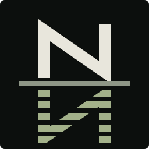

- **Desain.** Huruf N di atas garis cakrawala, dengan pantulannya (И) yang bergaris-garis dalam
  warna sage di bawah garis.
- **Filosofi.** Fata Morgana menumpuk citra tegak dan terbalik di cakrawala, sehingga kapal atau
  kota tampak nyata padahal tidak ada. Dunia umpan NEXA adalah fatamorgana bagi agen: konsisten
  dan meyakinkan, tetapi bukan sistem asli. Garis cakrawalanya adalah reverse proxy yang
  memisahkan yang nyata dari pantulannya.
- **Catatan.** Ceritanya mudah dijelaskan. Garis pantulan menipis di 16 px, tetapi N tetap
  terbaca.

### 08 · Loreng Piksel: tersembunyi di depan mata

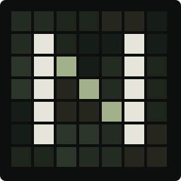

- **Desain.** Huruf N piksel 7×7 yang muncul dari sel loreng digital, dengan diagonal berwarna
  sage.
- **Filosofi.** Deception adalah kamuflase: sistem asli tersembunyi di antara umpan. Tanda ini
  memakai bahasa visual yang sama dengan loreng dashboard dan wordmark footer, jadi seluruh
  identitas NEXA terasa satu keluarga. Diagonal sage adalah jalur agen yang ketahuan.
- **Catatan.** Paling konsisten dengan identitas yang sudah ada dan sangat tajam sebagai favicon.
  Motif lorengnya hanya terinspirasi, bukan lambang institusi.

### 09 · Ouroboros: penyerang memakan dirinya sendiri

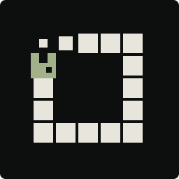

- **Desain.** Ular piksel membentuk lingkaran persegi. Kepala sage dengan mulut terbuka
  menggigit ekornya yang menyempit.
- **Filosofi.** Ouroboros, ular yang memakan ekornya, adalah lambang siklus tanpa akhir. Di NEXA,
  setiap halaman yang dibaca agen membakar token milik penyerang sendiri (denial-of-wallet):
  semakin rakus ia menjelajah, semakin banyak ia memakan dirinya sendiri.
- **Catatan.** Jenaka dan mudah diingat, dengan nuansa game retro.

### 10 · Honeylink: pintu yang hanya dilihat mesin

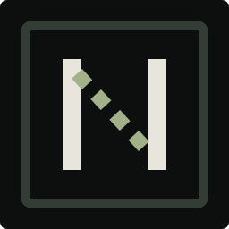

- **Desain.** Evolusi dari logo lama: bingkai yang sama dan dua tiang N, tetapi diagonalnya
  diganti garis putus-putus sage.
- **Filosofi.** Honeylink adalah tautan yang disembunyikan dari manusia tetapi diikuti bot.
  Manusia melihat dua tiang, gerbang biasa. Mesin melihat jalur tersembunyi di antaranya dan
  mengikutinya ke labirin. Logo ini sendiri adalah sebuah honeylink.
- **Catatan.** Transisi paling mulus dari logo lama (ikon desktop, favicon, dashboard), dan
  paling jelas di ukuran kecil.

### 11 · Kartika: bintang satu jalur

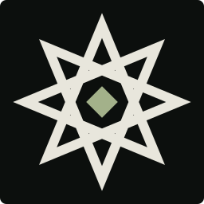

- **Desain.** Bintang delapan sudut {8/3} yang digambar dengan satu garis tanpa putus, dengan
  berlian sage di pusatnya.
- **Filosofi.** Kartika (Sanskerta *Kṛttikā*, gugus Pleiades) adalah bintang penunjuk arah
  sekaligus nama hackathon ini. Bintangnya digambar dengan satu jalur yang terus berbalik tanpa
  ujung: bagi penyerang ia labirin, bagi operator ia penunjuk arah. Delapan sudutnya mewakili
  delapan arah pengawasan.
- **Catatan.** Geometri bintang ini umum dalam ornamen Nusantara. Bentuknya orisinal dan bukan
  turunan lambang institusi mana pun; jangan dipasangkan dengan lambang resmi.

### 12 · Benang Ariadne: pemegang benang tak pernah tersesat

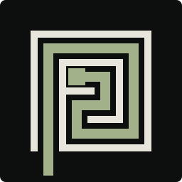

- **Desain.** Labirin persegi 4×4 berdinding tipis. Benang sage tebal masuk dari celah kiri
  bawah, menyusuri seluruh labirin, dan berakhir di simpul di pusat.
- **Filosofi.** Ariadne memberi Theseus benang untuk keluar dari labirin. Di NEXA, benang itu
  dipegang pembela: setiap langkah agen terekam di linimasa sesi, dan setiap canary menjadi
  simpul pada benangnya. Yang tersesat adalah penyerang; yang memegang benang adalah operator.
- **Catatan.** Menonjolkan perekaman sesi, kemampuan yang sering tidak terlihat.

## Rekomendasi

1. **01 Simpul.** Maknanya paling kuat (nama, N, X, dan ∞ dalam satu tanda), monogramnya
   eksklusif, dan tajam di semua ukuran.
2. **05 Gunungan.** Paling khas Indonesia dan paling mudah diingat. Cerita dalangnya sangat kuat
   di depan juri Kartika Cyber.
3. **10 Honeylink.** Evolusi yang aman dari logo lama: aset lama tinggal diperbarui, dan paling
   jelas di 16 px.

Alternatif: **08 Loreng Piksel**, bila ingin identitas loreng menyatu penuh.

## Penyempurnaan

Konsep 01 disempurnakan lewat tiga putaran eksplorasi:

- ujung tajam, melengkung, atau dipancung;
- tebal garis 6–9;
- proporsi persegi sampai melebar;
- aksen sage di garis, di titik silang, atau tanpa aksen.

Yang dipilih adalah varian a3: satu goresan tanpa celah di persilangan, tebal 8, berujung
dipancung, dan tanpa aksen. Logo ini sudah dipasang di landing, dashboard, dan ikon desktop.
Konstruksi, filosofi, dan aturan pakainya ada di [logo.md](logo.md).

## Sumber

- Etimologi *nexus*/*nexa*: [Wiktionary (mirror)](https://dictionary.wikideck.com/nexus),
  [Dictionary.com](https://www.dictionary.com/browse/nexus),
  [Merriam-Webster](https://www.merriam-webster.com/dictionary/nexus)
- Labirin klasik dan koin Knossos: [Wikipedia: Labyrinth](https://en.wikipedia.org/wiki/Labyrinth)
- Kurva Hilbert: [Compuphase](https://www.compuphase.com/hilbert.htm),
  [Resonance (IAS)](https://www.ias.ac.in/article/fulltext/reso/005/12/0026-0033)
- Gunungan: [Kompas](https://regional.kompas.com/read/2022/02/02/180653778/sejarah-dan-filosofi-gunungan-wayang-kulit-digunakan-dalam-uang-logam?page=all),
  [Pemkab Kebumen](https://kebumenkab.go.id/index.php/web/news_detail/2/2359),
  [Detik](https://www.detik.com/edu/detikpedia/d-7587505/gunungan-wayang-fungsi-jenis-simbol-dan-filosofinya)
- Borobudur: [Wikipedia: Borobudur](https://en.wikipedia.org/wiki/Borobudur),
  [Soekmono 1976](https://os.pennds.org/archaeobib_filestore/pdf_articles/Books/1976_Soekmono.pdf)
- Kartika: [kaikki.org (Wiktionary Indonesia)](https://kaikki.org/idwiktionary/bahasa%20Indonesia/meaning/k/ka/kartika.html),
  [Kompas Sains](https://sains.kompas.com/read/2014/04/10/2146458/Lintang.Kartika.Bintangnya.Bintang.Orang.Jawa?page=all)
- Fata Morgana: [Wikipedia](https://en.wikipedia.org/wiki/Fata_Morgana_(mirage)),
  [Andrew Young, SDSU](https://aty.sdsu.edu/mirages/mirintro.html)
- Anduril dan Palantir: [Wikipedia: Anduril](https://en.wikipedia.org/wiki/Anduril),
  [The Register](https://www.theregister.com/2024/12/09/palantir_anduril_alliance/)
