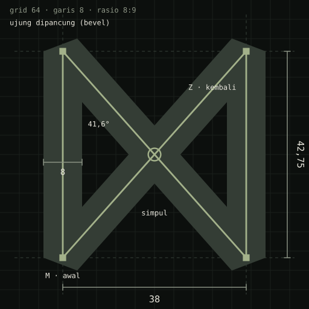

# Logo NEXA: Simpul

Logo ini ditetapkan pada 12 November 2026. Asalnya konsep 01 Simpul (lihat
[logo-concepts.md](logo-concepts.md)), yang disempurnakan menjadi satu goresan tertutup tanpa celah,
lebih tebal, dan berujung dipancung (varian a3 dari putaran eksplorasi).

## Bentuk

- Logo dibentuk dari huruf N: tiang kiri naik, diagonal turun, lalu tiang kanan naik. Goresan
  itu kemudian ditutup kembali ke titik awalnya. Diagonal penutup menyilang diagonal N tepat di
  tengah, sehingga N, X, dan ∞ terbaca dalam satu tanda.
- Dalam SVG, seluruh tanda adalah satu path: `M13 53.375V10.625L51 53.375V10.625Z`. Perintah
  terakhirnya, `Z` (closepath), yang mengubah huruf N menjadi simpul.
- Logo hanya satu warna. Tidak ada bingkai, aksen, atau celah di persilangan.

## Filosofi

1. **Terikat, tanpa ujung.**
   - *Nexa* adalah bentuk feminin participle Latin *nexus*, dari *nectō* "mengikat".
   - Tanda ini bisa digambar sekali jalan tanpa mengangkat pena dan berakhir di titik awal.
     Dalam teori graf, jalur seperti ini disebut sirkuit Euler. Empat sudutnya berderajat dua dan
     titik silangnya berderajat empat. Karena semuanya genap, jalurnya selalu kembali ke awal.
   - Agen yang masuk akan berputar di jalur yang sama tanpa menemukan ujung, seperti labirin
     umpan NEXA yang tidak punya jalan buntu.
2. **Mengikat, lalu menyimpulkan.**
   - KBBI mendefinisikan *simpul* sebagai "ikatan pada tali atau benang".
   - Kata kerjanya, *menyimpulkan*, punya dua arti: "mengikatkan hingga menjadi simpul" dan
     "mengikhtisarkan … berdasarkan apa-apa yang diuraikan".
   - NEXA melakukan keduanya. Agen diikat di labirin, lalu rekaman sesinya disimpulkan menjadi
     intelijen dan draf aturan yang menunggu persetujuan operator.
3. **Titik silang adalah simpul graf.**
   - Dalam teori graf berbahasa Indonesia, *simpul* adalah istilah untuk *vertex*.
   - Labirin NEXA berupa graf halaman umpan. Titik silang di tengah logo adalah simpul tempat
     semua jalur bertemu, sama seperti posisi NEXA sebagai reverse proxy yang memutuskan apakah
     permintaan diteruskan atau dibelokkan.
4. **Yang asli dan bayangannya.**
   - Tanda ini adalah N dan cerminannya (И) dalam satu goresan.
   - Dari luar, sistem asli dan dunia umpan tidak bisa dibedakan. Hanya simpul di tengah yang
     tahu bedanya, dan itulah inti deception.
5. **Ujung dipancung.**
   - Ujung lancip sengaja dipotong agar tanda ini tidak terlihat menusuk.
   - Ini mencerminkan NEXA sebagai alat penangkalan yang hanya bertahan, tanpa serangan balik
     (AGENTS.md §2).
   - Hasilnya siluet yang padat dan kokoh.

## Konstruksi

| Unsur | Nilai (grid 64) |
|---|---|
| Garis tengah | (13; 53,375) → (13; 10,625) → (51; 53,375) → (51; 10,625), lalu `Z` |
| Lebar × tinggi garis tengah | 38 × 42,75, rasio 8:9 (sama dengan konsep 01) |
| Tebal garis | 8 |
| Sudut tiang dan diagonal | 41,6° |
| Sambungan | bevel (ujung dipancung) |
| Kotak batas tanda | 46 × 48,07, berpusat di (32, 32) |
| viewBox | `6 6 52 52` untuk tanda, `4 4 56 56` untuk ikon berlatar |

## Versi

| Versi | File | Pemakaian |
|---|---|---|
| Utama | [`logo/nexa-mark.svg`](logo/nexa-mark.svg) | Warna tulang `#E8E6DC` (`--text`) di latar gelap |
| Latar terang | [`logo/nexa-mark-light.svg`](logo/nexa-mark-light.svg) | `#0C0F0D` di latar terang |
| Ikon | [`logo/nexa-icon.svg`](logo/nexa-icon.svg) | Latar `--bg`, sudut 6/56; favicon landing dan dashboard |
| Ikon desktop | `apps/desktop/build/icon.ico`, `icon.png` | Dibuat `make-icon.py`. Ukuran 16–48 px hanya berisi logo; ukuran besar ditambah pita loreng di dasar |

## Lockup dengan wordmark

- Wordmark ditulis "NEXA" dengan Geist 600 dan letter-spacing 0,16em.
- Ukuran SVG tanda kira-kira 1,4 kali ukuran font wordmark. Jarak antara tanda dan wordmark
  10–22 px, mengikuti ukurannya.

| Tempat | Tanda | Teks |
|---|---|---|
| Header landing | 22 px | 15 px |
| Sidebar dashboard | 26 px | 18 px |
| Bilah judul desktop | 16 px | 12 px |
| Halaman masuk | 28 px | 20 px |

## Aturan pakai

- Sisakan ruang kosong di sekeliling tanda minimal setebal satu garis (8 unit, kira-kira 1/6
  lebar tanda).
- Ukuran minimum 16 px.
- Jangan lakukan hal berikut:
  - menambahkan bingkai, garis bawah, gradien, bayangan, glow, atau outline;
  - memutar atau memiringkan tanda;
  - membuat celah di persilangan;
  - mengembalikan ujung lancip;
  - memakai warna selain tulang dan `--bg`;
  - menyandingkan logo dengan lambang resmi TNI AD/PUSSIBERAD.

## Lokasi di kode

Semua tempat di bawah memakai geometri yang sama. Kalau geometrinya berubah, ubah semua sekaligus.

- Dashboard: `apps/dashboard/src/components/LogoMark.tsx`. Favicon-nya berupa data URI di
  `apps/dashboard/index.html`.
- Landing:
  - header di `apps/landing/index.html`
  - `apps/landing/public/favicon.svg`
  - `apps/landing/public/og.png`
  - dashboard tiruan di `apps/landing/src/modules/reel-mock.ts`
- Desktop: `apps/desktop/build/make-icon.py`, yang menghasilkan `icon.ico` dan `icon.png`.

## Sumber

- Etimologi *nexus* dan *nexa*: [Wiktionary (mirror)](https://dictionary.wikideck.com/nexus),
  [Dictionary.com](https://www.dictionary.com/browse/nexus)
- KBBI, lema *simpul*, *menyimpulkan*, dan *simpulan*:
  [kbbi.web.id/simpul](https://kbbi.web.id/simpul)
- Simpul (*vertex*), derajat simpul, dan lintasan serta sirkuit Euler (Rinaldi Munir, ITB):
  - [Graf (2015)](https://informatika.stei.itb.ac.id/~rinaldi.munir/Matdis/2015-2016/Graf%20(2015).pdf)
  - [Graf Bagian 3 (2024)](https://informatika.stei.itb.ac.id/~rinaldi.munir/Matdis/2024-2025/22-Graf-Bagian3-2024.pdf)
